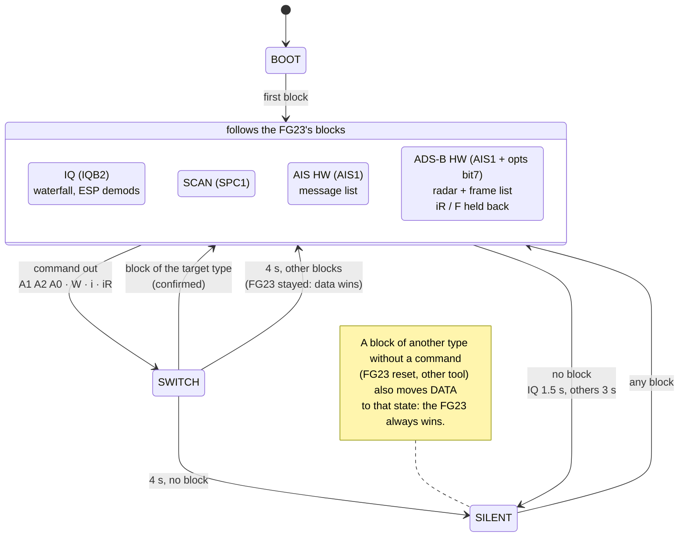

# FG23 radio state machine (ESP32 side)

The ESP32 programs the FG23 over the cmdlink, but **what the FG23 actually runs
is decided by the blocks it sends**. `radio_sm.cpp` keeps one state for it; the
displays and the I/Q-only requests follow that state, not the last command.

| State | Evidence (block) | TFT header | TFT body | OLED |
|---|---|---|---|---|
| BOOT | none yet | `FG23 BOOT`, "waiting for the FG23" | waterfall | normal pages |
| IQ | IQB2 (I/Q) | `FG23 IQ 100k`, band scale | waterfall | normal pages |
| SCAN | SPC1 | `FG23 SCAN`, band scale | scan waterfall | normal pages |
| AIS HW | AIS1, telemetry opts bit7 = 0 | `FG23 AIS chip A`, `161.975 MHz AIS on-chip ch A nf … dBm` | newest AIS messages (time UTC, ch, HW/IQ, dBm, Δf, text) | on-chip page |
| ADS-B HW | AIS1, telemetry opts bit7 = 1 | `FG23 ADS-B chip`, `1090.000 MHz Mode S on-chip AM thr …` | radar (range auto 25…400 km, ■ FG23 heard it, □ RTL-SDR only, colour = altitude) + 10 newest frames (`F` FG23 / `R` RTL-SDR) | on-chip page |
| SWITCH | a command went out | `FG23 >target`, `-> target (cmd) n s` | previous view | tag = SWITCH |
| SILENT | no block (IQ 1.5 s, others 3 s) | `FG23 SILENT`, `no blocks n s, last …, cmd …` | on-chip view if it went silent on-chip | tag = SILENT |

Commands that open a SWITCH window: `A1`/`A2` (target ADS-B HW if `AC4000` or
`AM<thr>` was set, else AIS HW; an `AM<thr>` after `A1` retargets), `A0`, `W…`,
`W0`, `i`, `i<R>`. `F<kHz>`, `AC<ch>`, `AM<thr>` only update the target
parameters. The SWITCH window closes on the first block of the target type; after
4 s it falls to the state the blocks show ("FG23 stayed"), or SILENT if none came.
A block of another type without any command moves the state too (FG23 reset,
another tool driving it).

**Guard.** While the FG23 is on-chip, being switched there, or went silent in it,
`i<R>` (stream decimation) and `F<kHz>` (tuning) are **held back** and go out
after it is back in IQ. A stream restart sent between `AC4000` and `A1` had left
ID1's ADS-B monitor deaf for three hours (2026-11-25).

Console: `RSM` prints the state, the target, the last command and the last 12
transitions; every transition is logged as `RSM: X -> Y : why`.
